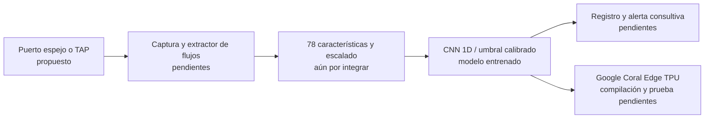

# Plan de aplicación, etapas y viabilidad — EdgeGuard

**Fecha de actualización:** 15 de noviembre de 2026

**Estado:** propuesta de intervención y ruta técnica; el escenario institucional todavía debe confirmarse.

## 1. Denominación y propósito

**EdgeGuard — prototipo de detección binaria de intrusiones de red mediante Edge AI.** El proyecto busca clasificar flujos de red como benignos o potencialmente maliciosos en el borde de una red, usando una CNN 1D y, como destino previsto, una Raspberry Pi 4 con Google Coral Edge TPU.

El problema técnico que aborda es la necesidad de analizar tráfico de red y señalar flujos sospechosos cerca del segmento observado. El procesamiento local podría reducir la dependencia de enviar todos los datos a un servidor central y facilitar una respuesta oportuna; estos beneficios son objetivos del diseño, no resultados medidos todavía. La evaluación actual es offline y no demuestra detección en una red operativa.

## 2. Qué se ha realizado

Se procesaron los ocho CSV de MachineLearningCSV.zip. El resultado contiene 2.827.876 registros limpios y 78 características. Las etiquetas se agruparon en dos clases: BENIGN y ATTACK. La partición fue estratificada 80/20 con semilla 42, y StandardScaler se ajustó únicamente con los datos de entrenamiento.

Se entrenó una CNN 1D con pesos por clase, parada temprana y reducción de tasa de aprendizaje. La ejecución concluyó en cuatro épocas y restauró los mejores pesos de validación. Sobre los 565.576 registros de prueba, con umbral 0,5, obtuvo AUC ROC 0,989 y recall ATTACK 0,661; ese punto de operación omitió 37.715 ataques.

Para estudiar ese intercambio, se añadió calibración de umbral en una partición de validación separada del conjunto de prueba. El umbral 0,059791 se eligió para priorizar recall de ataques de al menos 0,95 en validación. En prueba obtuvo recall 0,948, precisión ATTACK 0,814 y F1 ATTACK 0,876; identificó 105.524 de 111.311 ataques, pero produjo 24.161 falsos positivos. Es una mejora de sensibilidad con más falsas alarmas, no una garantía de uso en producción.

El modelo se convirtió a TFLite con cuantización entera INT8 usando 300 ejemplos representativos de entrenamiento. Se verificaron entradas y salidas INT8; el archivo resultante mide 187.040 bytes. El benchmark CPU se ejecutó sobre 1.000 ejemplos de prueba, con semilla 42 y diez inferencias de calentamiento. Al umbral calibrado midió recall ATTACK 0,710, F1 ATTACK 0,810 y latencia media de 0,0430 ms en Windows 11 con XNNPACK. Estas cifras describen ese PC y esa muestra, no Raspberry Pi ni Coral.

Los scripts, métricas y evidencias pequeñas están documentados en el README y en las rutas del repositorio. No se subieron el ZIP, los arrays ni los pesos binarios del modelo.

## 3. Función de los componentes

| Componente | Función actual | Qué se busca en la siguiente etapa |
|---|---|---|
| Preparación de datos | Limpiar CSV, mapear etiquetas, verificar 78 características, separar datos y ajustar el escalador sin fuga desde prueba. | Reproducir exactamente el mismo orden y escalado cuando se procesen flujos de una red autorizada. |
| CNN 1D | Recibir un vector de 78 características y producir una probabilidad de ATTACK. La salida actual es binaria; no identifica la familia del ataque. | Revisar recall, F1 y falsos positivos en escenarios representativos y ajustar el punto de operación con datos de validación. |
| Calibrador | Elegir un umbral con la validación de entrenamiento, sin usar el conjunto de prueba para decidirlo. | Definir con los responsables del escenario el costo aceptable de ataques omitidos frente a falsas alarmas. |
| TFLite INT8 | Reducir la representación del modelo y verificar entrada/salida enteras. | Compilar el modelo compatible con Edge TPU y revisar qué operaciones se ejecutan realmente en el acelerador. |
| Benchmark | Medir métricas y latencia por registro en CPU; incluye cuantización de entrada, invocación y lectura de salida, pero no extracción del flujo. | Comparar CPU y Coral con la misma muestra, semilla, umbral y condiciones del equipo objetivo. |
| Captura, extracción y alertas | No están implementadas. | Leer una copia autorizada del tráfico, convertirla en las mismas 78 características y generar avisos auditables sin bloquear tráfico. |

## 4. Arquitectura prevista y lugar de aplicación

La aplicación inicial propuesta es un **laboratorio académico o segmento piloto controlado** del escenario de práctica, una vez identificados y autorizados por la institución. Un puerto espejo SPAN o un TAP de red entregaría una copia pasiva del tráfico al equipo de borde; EdgeGuard analizaría los flujos y reportaría observaciones. En la fase piloto no se ubicaría como dispositivo inline ni bloquearía conexiones.

El objetivo físico es Raspberry Pi 4 más Google Coral Edge TPU, pero no se ha definido el modelo exacto de acelerador ni se dispone del dispositivo para esta validación. El lugar institucional, el segmento de red, la cantidad de equipos cubiertos y el responsable de infraestructura no están confirmados. Por tanto, “laboratorio o red de práctica” es el escenario propuesto, no una instalación existente.

Para una aplicación futura, el extractor tendría que generar los mismos 78 campos que el entrenamiento, en igual orden, unidades y tratamiento de valores. Si esa correspondencia falla, el modelo recibirá datos distintos de los que aprendió y sus resultados dejarán de ser comparables. El conjunto CIC-IDS-2017 ofrece flujos CSV etiquetados para investigación; su artículo de origen describe las capturas y ataques (Sharafaldin et al., 2018). Trabajos posteriores han examinado problemas de captura y etiquetado, por lo que la validación del conjunto y la evaluación por escenarios son necesarias (Engelen et al., 2021; Lanvin et al., 2023).

## 5. Objetivos de la intervención

### Objetivo general

Construir y evaluar un prototipo de clasificación binaria de flujos de red en el borde, documentando su preparación de datos, desempeño, cuantización y viabilidad de ejecución en una plataforma Raspberry Pi 4 con Google Coral Edge TPU.

### Objetivos específicos

1. Preparar CIC-IDS-2017 con una canalización reproducible, un orden fijo de características y separación sin fuga entre entrenamiento, validación y prueba. **Estado: ejecutado.**
2. Entrenar y evaluar una CNN 1D con métricas por clase y una revisión explícita del balance entre ataques omitidos y falsas alarmas. **Estado: evaluación inicial ejecutada; desempeño operativo por mejorar y validar en contexto.**
3. Calibrar el umbral en validación y convertir el modelo a TFLite INT8. **Estado: ejecutado en entorno Windows/CPU.**
4. Compilar y medir el modelo en Coral, comparándolo con CPU bajo condiciones controladas. **Estado: pendiente por falta de hardware y compilador compatible.**
5. Diseñar e integrar captura pasiva, extracción de características y registro de alertas en una red autorizada. **Estado: pendiente; no existe hoy un NIDS en vivo.**
6. Evaluar un piloto con criterios acordados con la institución y documentar sus resultados, límites y recomendaciones. **Estado: pendiente de definir escenario, responsables y avales.**

## 6. Etapas y entregables

| Etapa | Acciones | Estado | Entregable o criterio de salida |
|---|---|---|---|
| 0. Delimitación institucional | Confirmar DOFA, necesidad prioritaria, responsables, segmento de red, beneficiarios, reglas de acceso y revisión ética. | Pendiente de información institucional. | Alcance y plan aprobados; no se captura tráfico institucional antes de autorización. |
| 1. Preparación de datos | Procesar los ocho CSV, verificar etiquetas, 78 campos, conteos y escalado. | Ejecutada. | dataset_summary.json, nombres de características y arrays locales reproducibles. |
| 2. Entrenamiento y evaluación | Entrenar CNN, guardar reporte, curva de entrenamiento y matriz de confusión. | Ejecutada como línea base. | Métricas completas en 565.576 registros; las limitaciones y errores están descritos. |
| 3. Calibración y cuantización | Elegir el umbral en validación y generar modelo con entrada/salida INT8. | Ejecutada. | JSON de calibración y metadatos TFLite; el umbral no se ajusta sobre prueba. |
| 4. Compatibilidad Coral | Instalar herramientas en Linux compatible, compilar, inspeccionar operaciones asignadas y ejecutar PyCoral. | Pendiente. | Log del compilador, archivo compilado y verificación del delegado Edge TPU. |
| 5. Entrada de tráfico real | Configurar TAP/SPAN en laboratorio, extraer características, aplicar el mismo escalador y comparar con referencia. | Pendiente. | Registros trazables de flujos benignos y pruebas autorizadas, sin acciones de bloqueo. |
| 6. Alertas y piloto | Emitir alertas consultivas, medir falsos avisos, tiempos, consumo y estabilidad por periodo. | Pendiente. | Evidencia reproducible del piloto y evaluación posterior frente a línea base. |
| 7. Cierre académico | Analizar resultados, documentar fallos, limitaciones, recursos, costos y recomendaciones. | Parcial; documentación técnica actualizada. | Informe APA final con datos institucionales confirmados y anexos de evidencia. |

Las etapas se ejecutan en ese orden: no conviene probar tráfico en vivo antes de asegurar el formato de 78 características, autorización del sitio y compatibilidad del modelo con el hardware. Las fechas, duración y horas no se fijan aquí porque no se ha recibido el calendario aprobado de práctica.

## 7. Viabilidad

**Técnica: parcial y condicionada.** Está comprobado el procesamiento offline, el entrenamiento, la evaluación, la calibración y la conversión INT8 en CPU. Aún no están demostrados la compilación, la delegación de operaciones, la latencia en Coral ni el flujo de captura a inferencia. El recall de ataques de 0,948 con umbral calibrado todavía implica 5.787 ataques omitidos en el conjunto de prueba y 24.161 falsos positivos; la institución debe determinar si ese equilibrio tiene utilidad. Una CNN 1D para detectar ataques en CIC-IDS-2017 es un enfoque investigado, aunque los resultados publicados no son directamente comparables sin igualar datos, limpieza, particiones y métricas (Singh et al., 2021).

**Operativa: viable como piloto pasivo, si se habilita infraestructura.** Se requiere acceso autorizado a un puerto espejo/TAP, un equipo Raspberry Pi 4, Coral compatible, alimentación y refrigeración adecuadas, software de captura/extracción, mantenimiento y una persona responsable de revisar alertas. Ninguno de esos componentes de operación en vivo está instalado y probado aquí.

**Económica: todavía indeterminada.** El pipeline de software usa herramientas disponibles en el proyecto, pero no hay cotizaciones ni presupuesto aprobado para Raspberry Pi, acelerador, red de prueba, almacenamiento, desplazamientos o tiempo de personal. No se asignan costos ficticios.

**Ética y privacidad: condicionada a aval y minimización.** No se debe capturar tráfico de una institución hasta obtener autorización y definir finalidad, datos visibles, retención, acceso, anonimización y tratamiento de incidentes. Debe confirmarse si se requiere aval ético. El modo inicial propuesto es pasivo y consultivo, sin inspección dirigida a personas ni bloqueo automático.

**Conclusión de viabilidad:** EdgeGuard es viable como prototipo académico de clasificación offline y como candidato a un piloto controlado. No está listo para presentarse como NIDS en tiempo real ni para producción. La viabilidad de campo depende de completar el hardware Coral, la extracción de flujos en vivo, la calibración con datos del sitio, la aprobación institucional y el análisis de falsas alarmas.

## 8. Indicadores de evaluación propuestos

- **Integridad de datos:** número de archivos procesados, filas válidas, 78 características presentes y en el orden definido.
- **Desempeño del clasificador:** precisión, recall, F1 y AUC por clase; matriz de confusión; número de ataques omitidos y falsas alarmas. Separar resultados de validación, prueba y piloto.
- **Ejecución en borde:** tamaño del modelo, operaciones delegadas, latencia media/P95, throughput, memoria, CPU y temperatura en el mismo hardware.
- **Operación:** flujos observados, alertas revisadas, falsas alarmas por hora/periodo, disponibilidad y fallas de extracción.
- **Impacto de intervención:** comparación de diagnóstico inicial y evaluación posterior con instrumento acordado por la institución.

El único objetivo numérico de recall actualmente usado (0,95) fue una regla de calibración técnica en la validación; no constituye una meta institucional aprobada. Deben fijarse criterios de aceptación antes del piloto. La latencia CPU de 0,0430 ms es una medición de 1.000 ejemplos en Windows 11 y no debe usarse como umbral de aceptación para Coral.

## 9. Información pendiente para el informe de práctica

Para convertir este plan en informe institucional final todavía se requiere: matriz DOFA y acciones de intervención; escenario y dirección/sede de práctica; beneficiarios directos e indirectos; responsables y roles; calendario y fechas aprobadas; recursos y presupuesto real; documento de aval o revisión ética; protocolo de autorización y protección de datos; e instrumento diagnóstico y posterior. No se atribuyen beneficiarios, impactos institucionales ni ahorros económicos sin esa evidencia.

## Referencias de apoyo

Canadian Institute for Cybersecurity. (s. f.). *Intrusion detection evaluation dataset (CIC-IDS2017).* University of New Brunswick. https://www.unb.ca/cic/datasets/ids-2017.html

Engelen, G., Rimmer, V., & Joosen, W. (2021). Troubleshooting an intrusion detection dataset: The CICIDS2017 case study. En *2021 IEEE Security and Privacy Workshops (SPW)* (pp. 7–12). IEEE. https://doi.org/10.1109/SPW53761.2021.00009

Lanvin, M., Gimenez, P. F., Han, Y., Majorczyk, F., Mé, L., & Totel, É. (2023). Errors in the CICIDS2017 dataset and the significant differences in detection performances it makes. En S. Kallel et al. (Eds.), *Risks and security of internet and systems: CRiSIS 2022* (Vol. 13857, pp. 18–33). Springer. https://doi.org/10.1007/978-3-031-31108-6_2

Sharafaldin, I., Lashkari, A. H., & Ghorbani, A. A. (2018). Toward generating a new intrusion detection dataset and intrusion traffic characterization. En *Proceedings of the 4th International Conference on Information Systems Security and Privacy (ICISSP)* (pp. 108–116). SCITEPRESS. https://doi.org/10.5220/0006639801080116

Singh, K., Mahajan, A., & Mansotra, V. (2021). 1D-CNN based model for classification and analysis of network attacks. *International Journal of Advanced Computer Science and Applications, 12*(11). https://doi.org/10.14569/IJACSA.2021.0121169
